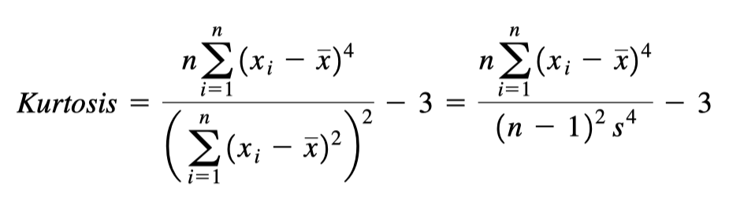

Imágenes
========

**Imagen Sagital**

.. image:: corte_sagital.png

Medida para evaluar que tan parecido es la distribución de los datos con la distribución normal.

Medida para evaluar que tan simetrica es la distribución de los datos.

.. image:: simetria.png

Formulas para carcular algunos cuartiles.

.. image:: cuartiles.png
