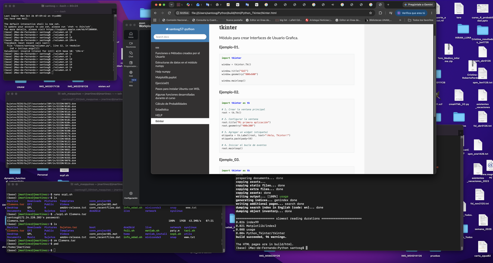

tkinter
=======

Lo que puede hacer tkinter

Módulo para crear Interfaces de Usuario Grafica.

**Ejemplo-01.**

.. code:: Python

   import tkinter

   window = tkinter.Tk()

   window.title("GUI")
   window.geometry("800x600")

   window.mainloop()

**Ejemplo-02.**

.. code:: Python

   import tkinter as tk

   # 1. Crear la ventana principal
   root = tk.Tk()

   # 2. Configurar la ventana
   root.title("Mi primera aplicación")
   root.geometry("400x300")

   # 3. Agregar un widget (etiqueta)
   etiqueta = tk.Label(root, text="¡Hola, Tkinter!")
   etiqueta.pack(pady=50)

   # 4. Iniciar el bucle de eventos
   root.mainloop()

**Ejemplo_03.**

.. code::

   import tkinter as tk

   def saludar():
     print("¡Hola, familia!")

   # 1. Crear la ventana principal
   root = tk.Tk()

   # 2. Configurar la ventana
   root.title("Mi primera aplicación")
   root.geometry("400x300")

   # 3. Agregar un widget (etiqueta)
   etiqueta = tk.Label(root, text="¡Hola, Tkinter!")
   etiqueta.pack(pady=5)

   boton = tk.Button(root, text="¡Hola, mundo!", command=saludar)
   boton.pack(pady=5)

   # 4. Iniciar el bucle de eventos
   root.mainloop()

