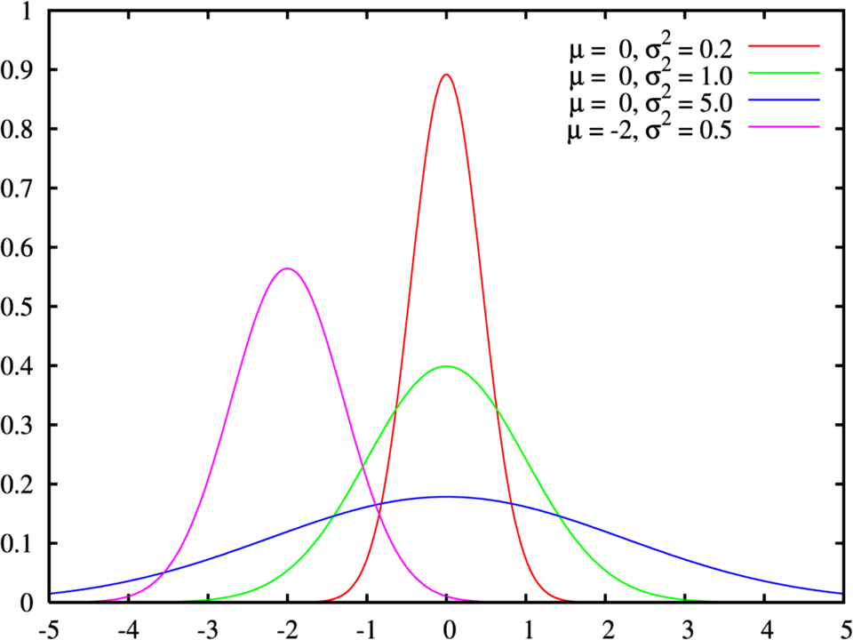
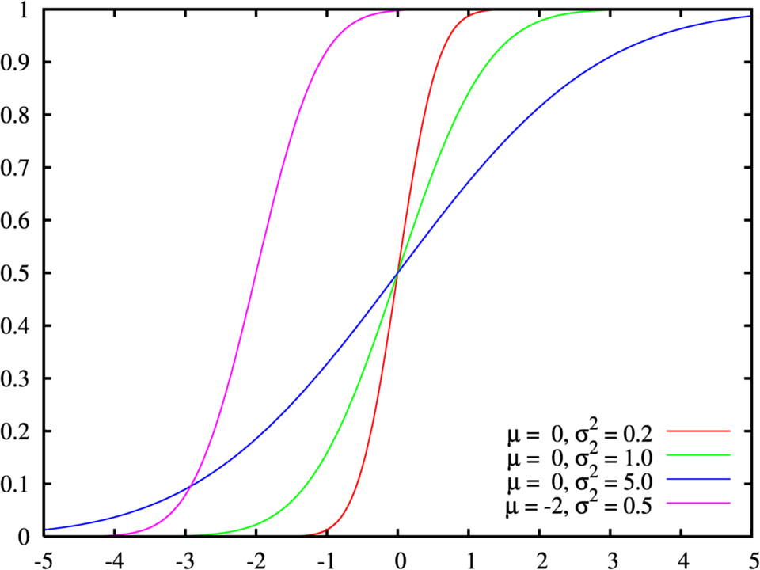

Distribución normal
===================

**Función de densidad de probabilidad**

**Función de distribución de probabilidad**

Para calcular la probabilidad de una distribución normal en Python, se utiliza principalmente la librería **SciPy** (a 
través 
de ``scipy.stats.norm``), la cual permite trabajar con la función de distribución acumulada (``cdf``), la función de 
densidad de 
probabilidad (``pdf``) y la función cuantil (``ppf``)

**Métodos principales en scipy.stats.norm**

• ``norm.cdf(x, loc=mu, scale=sigma)`` (Función de distribución acumulada): Calcula :math:`P(X \le x)`, es decir, la 
probabilidad 
acumulada desde menos infinito hasta el valor :math:`x`.

• ``norm.pdf(x, loc=mu, scale=sigma)`` (Función de densidad de probabilidad): Calcula el valor de la función de densidad 
en el 
punto :math:`x`.

• ``norm.ppf(q, loc=mu, scale=sigma)`` (Función cuantil o inversa): Dado un nivel de probabilidad :math:`q` (por 
ejemplo, 
\(0.95\)), devuelve el valor :math:`x` tal que :math:`P(X \le x) = q`

**Ejemplos prácticos en Python**

1. Calcular :math:`P(X \le x)` (Probabilidad acumulada inferior)

Si tienes una variable con media :math:`\mu = 100` y desviación estándar :math:`\sigma = 15`, y quieres saber cuál es 
la 
probabilidad de obtener un valor menor o igual a :math:`115`:

.. code:: Python

   from scipy.stats import norm

   mu = 100
   sigma = 15
   x = 115

   probabilidad = norm.cdf(x, loc=mu, scale=sigma)
   print(f"P(X <= {x}) = {probabilidad:.4f}")
   # Salida aproximada: P(X <= 115) = 0.8413 (84.13%)

2. Calcular :math:`P(X > x)` (Probabilidad superior)

Para calcular la probabilidad de obtener un valor mayor a :math:`x`, se resta la función acumulada de :math:`1`:

.. code:: Python

   probabilidad_mayor = 1 - norm.cdf(x, loc=mu, scale=sigma)
   print(f"P(X > {x}) = {probabilidad_mayor:.4f}")

3. Calcular :math:`P(a \le X \le b)` (Probabilidad en un intervalo)

Para calcular la probabilidad entre dos valores :math:`a` y :math:`b`, restas la acumulada del valor mayor menos la del 
valor 
menor:

.. code:: Python

   a, b = 90, 110
   prob_intervalo = norm.cdf(b, loc=mu, scale=sigma) - norm.cdf(a, loc=mu, scale=sigma)
   print(f"P({a} <= X <= {b}) = {prob_intervalo:.4f}")

